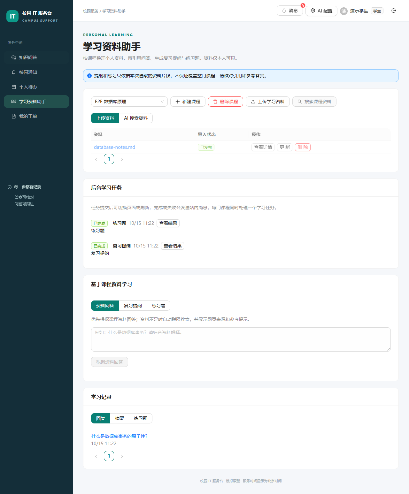
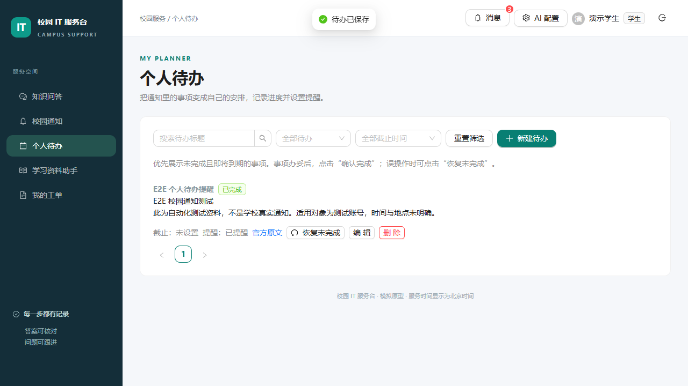
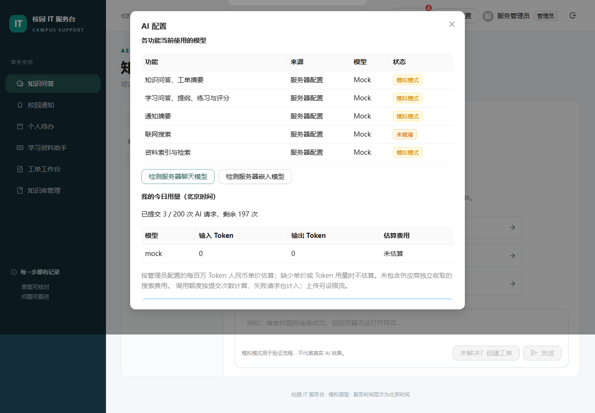

# 校园 IT 服务台与学习助手

一个面向校园服务与个人学习的全栈应用，将知识库问答、人工工单、校园通知和课程学习整合在同一工作台。适合用于体验 RAG（检索增强生成）、文档处理、异步任务及角色权限管理的完整业务流程。

管理员上传知识库资料，学生通过带来源问答寻求帮助；未解决时确认工单，由管理员回复处理并由学生关闭。学生还可以订阅校园通知、安排个人待办、上传课程资料，并生成复习提纲和练习题。

**新环境默认 Mock 模式，不需要 API 密钥。** 模拟结果用于验证产品流程，不代表真实 AI 效果。部署步骤以 [三条部署路径](docs/deployment-guide.md) 为准；当前机器的实际结果见 [2026-10-15 验收记录](docs/verification-2026-10-15.md)。

## 项目亮点

| 亮点 | 实现与体验 |
| --- | --- |
| 有来源的知识问答 | 向量检索结合中文 BM25，并通过 RRF 融合结果；回答支持流式展示和来源核对。真实模式可使用 DeepSeek 聊天与本地 BGE-M3 1024 维嵌入。 |
| 从问答到人工服务 | 用户确认后将未解决问题转为工单，支持管理员处理、双方补充信息、解决、重新打开与关闭，保留沟通和状态记录。 |
| 个人学习工作台 | 按课程组织资料，支持资料问答、复习提纲、练习生成、提交答案、评分与复习建议，学习记录可持续查看。 |
| 通知与待办衔接 | 管理员编辑并发布通知；用户订阅、收藏并加入个人待办，通过后台任务发送站内提醒。 |
| 权限与文档版本 | 区分公开知识、管理员资料和个人课程资料；检索与引用校验访问权限，新版本导入失败时保留旧版可用内容。 |
| 异步处理与进度恢复 | 文档导入、学习生成及提醒由 Celery、Redis 和 Scheduler 处理；页面展示状态，刷新后可继续查看任务。 |
| 模型状态与用量可见 | AI 配置页说明各功能的模型来源，提供连接检测、个人请求额度、Token 用量及可配置的费用估算。 |
| 可复现的部署与运维 | Docker Compose 管理服务，提供环境初始化、真实模型探测、50 题评测、备份与隔离恢复演练脚本。 |

## 界面演示

以下为本项目在本地验收时的实际界面，内容使用演示账号和测试资料。截图用于展示操作界面，不代表真实模型效果或正式校园业务数据。

### 学习资料助手

按课程上传资料，查看导入进度、后台任务与学习记录，并进行资料问答、生成提纲或练习。



### 个人待办

将通知转为个人安排，查看完成状态、来源与提醒情况，也可单独创建待办。



### AI 配置与用量

查看各功能使用的模型及运行模式，管理员可检测服务器模型；用户可查看自己的当日额度与用量。



## 快速开始

### 1. 准备环境并获取代码

准备 Git、PowerShell 和支持 Compose 的 Docker 环境。Windows 推荐使用 Docker Desktop，并确认 Linux 容器引擎已启动。Mock 模式通过容器运行服务，无需在主机单独安装 Python、Node.js、PostgreSQL 或 Redis。

```powershell
git clone https://github.com/tanxiangxin/it-work.git
Set-Location it-work
```

### 2. 初始化并启动

在项目根目录运行，首次执行会拉取镜像、构建服务、迁移数据库并初始化演示账号和示例知识库；`-Test` 会同时运行后端测试：

```powershell
powershell -File scripts/init-env.ps1
powershell -File scripts/start.ps1 -Test
```

### 3. 登录体验

浏览器访问 **http://localhost:8080**。这是本机启动后的地址，当前文档未提供公共在线体验站点。

| 角色 | 登录账号 | 初始密码位置 |
| --- | --- | --- |
| 学生 | `student@example.test` | 本地 `.env` 的 `DEMO_STUDENT_PASSWORD` |
| 管理员 | `admin@example.test` | 本地 `.env` 的 `DEMO_ADMIN_PASSWORD` |

初始化脚本生成随机密码，不使用统一公开密码。配置初始化不会覆盖已有文件，账号初始化不会修改已有密码。不要提交 `.env`。

### 4. 查看服务与停止项目

```powershell
docker compose ps
docker compose logs --tail 100 api worker scheduler
docker compose down
```

数据库、上传文件和 Redis 使用持久化卷保存；停止项目时保留数据卷。

## 项目的使用方式

### 知识问答与工单

1. 使用学生账号进入“知识问答”，输入“VPN 错误 809 怎么处理？”，查看回答及引用的知识库原文。
2. 问题仍未解决时，点击“未解决？创建工单”，核对标题、描述和地点后提交。
3. 管理员登录“工单工作台”，查看问题、回复信息并更新处理状态。
4. 学生补充信息、核对处理结果，确认解决后关闭工单；需要继续处理时可按界面操作重新打开。

### 维护知识库与发布通知

1. 管理员进入“知识库管理”，上传 MD、TXT、DOCX 或文本型 PDF，等待导入完成后查看发布版本与内容。
2. 根据资料用途设置公开或管理员可见，更新资料时上传新版本。
3. 进入“校园通知”，创建草稿并填写已核验的正文与官方链接；可用 AI 提取摘要及办理信息，人工核对后发布。
4. 学生订阅通知类别，收藏感兴趣的通知，并将事项加入个人待办，检查截止与提醒时间后保存。

### 课程学习与练习

1. 进入“学习资料助手”，新建课程，上传自己的讲义或笔记；可使用 [数据库示例笔记](samples/study/database-notes.md) 体验。
2. 等待资料显示“已发布”，再进行课程资料问答、生成复习提纲或练习题。
3. 完成练习后提交答案，查看评分、参考答案、引用与复习建议；可按建议继续生成复习提纲。
4. 在学习记录中查看历史结果。个人课程资料仅本人可见；真实模式中，选中的内容会发送给所配置的聊天供应商处理。

单文件上限为 20 MB，PDF 上限为 100 页；当前支持文本型 PDF，不支持扫描件 OCR 或 PPTX。Mock 评分仅比较答案文本，真实模式的 AI 评分也仅供学习参考。详细操作见 [校园通知、待办与学习助手](docs/campus-learning.md) 和 [演示流程](docs/demo.md)。

## 真实模型与效果验证

支持 DeepSeek 聊天 + 本地 Docker CPU `BAAI/bge-m3` 1024 维嵌入。先将模型配置和密钥填入本地 `.env`，再执行 `powershell -File scripts/enable-real.ps1`，完成探针检测、模式切换和索引重建。首次模型下载为数 GB。

AI 配置页显示各功能使用的模型、配置来源、连接检测和本人当日用量。个人聊天配置用于知识问答和工单摘要；学习、通知与联网搜索使用服务器配置，向量索引也由服务器统一管理。

[50 题评测集](samples/evaluation-50.json) 提供参考要点、来源及拒答预期，基于自编模拟资料，并非真实校园准确率基准。真实评测、人工核对和费用边界见 [部署指南](docs/deployment-guide.md)。缺少密钥时保留 Mock，不宣称真实模型验收通过。旧环境的模型调用与检索结果保留在历史文档中。

## 验证与运维

```powershell
docker compose --profile test run --build --rm tests
powershell -File scripts/backup.ps1
powershell -File scripts/verify-restore.ps1 -BackupDirectory work/backups/你的备份目录
```

前端以 `frontend/pnpm-lock.yaml` 为唯一安装依据，使用 `pnpm install --frozen-lockfile`；`package-lock.json` 是早期历史文件。Python 依赖由 `backend/uv.lock` 固定。浏览器验收使用 Playwright，命令见 [开发与运维](docs/operations.md)。

长期服务已配置自动重启和日志轮转，登录、AI 调用及上传具有额度和并发保护。价格需管理员自行配置，缺少价格或供应商 Token 用量时费用显示未估算。对外部署需要 HTTPS 和实际来源配置；备份应另存到独立存储。详细参数及恢复边界见 [部署指南](docs/deployment-guide.md)。

## 代码结构

```text
backend/app/          API、权限、模型、检索、后台任务和业务
backend/migrations/  Alembic 数据库迁移
backend/tests/       单元、权限、故障与集成测试
frontend/src/        React 页面与 SSE 客户端
frontend/e2e/        Playwright 浏览器验收
deploy/              Nginx 同源反向代理
samples/             自编示例、校园资料与评测问题
scripts/             启动、配置、评测、备份和隔离恢复
```

后端使用 Python 3.12、FastAPI、PostgreSQL/pgvector、Celery/Redis；前端使用 React、TypeScript、Vite、Ant Design 和 TanStack Query。检索采用向量 + 中文 BM25 + RRF，候选数量由配置控制。当前仍按单 API 进程部署。

## 功能和历史资料

- [校园通知、个人待办与学习资料助手](docs/campus-learning.md)
- [湖南工业大学公开服务知识库](docs/hut-knowledge.md)
- [架构与权限](docs/architecture.md)
- [演示流程](docs/demo.md)
- [检索对比工具](docs/retrieval-evaluation.md) 与 [历史对比结果](docs/retrieval-results.md)
- [BGE-M3 接入](docs/bge-m3-setup.md)、[历史真实模型记录](docs/real-results.md)
- [历史目标环境验收](docs/target-verification.md)

尚未接入学校统一认证、邮件、OCR、多部门流转、SLA 或自动处理工单。校园通知及 AI 学习结果应核对原文，练习评分仅作学习参考。
