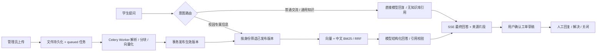

# 实现说明

## 核心数据流

## 权限与登录

登录页区分学生与管理端入口，分别说明问答/个人工单与资料/工单管理用途。前端发送可选 `entry_role=student|admin`；后端先验证密码，再核对数据库角色，入口不匹配返回403 `LOGIN_ENTRY_MISMATCH`，不创建登录会话。未传该字段的既有API客户端兼容原登录行为。选择入口不会改变账号角色或赋予权限。

角色从数据库登录身份读取，前端隐藏导航仅用于界面展示。学生的会话和工单按所有人筛选；不可访问的对象返回 404。管理接口返回 403。文档权限在数据库检索候选之前应用，来源接口重新校验权限。回答输出前再次检查撤回/权限变化；历史回答失去来源权限后隐藏正文；历史上下文也不向模型传递已失去权限的回答。

密码用 Argon2 哈希。随机会话令牌仅通过 HttpOnly、SameSite=Lax Cookie 传输，数据库存令牌 SHA-256 和七天过期时间；HTTPS 部署启用 Secure。写操作拒绝不匹配的 Origin 和跨站 Sec-Fetch-Site；无浏览器来源头的 CLI 请求仍按登录权限处理。密钥只进入后端环境变量。

## 文档、版本与任务

文件随机命名，原始名称仅显示，存储目录不作静态资源。上传 20 MB、PDF 100 页；DOCX 解压内容限 50 MB，提取文本限 200 万字符。TXT/MD 为 UTF-8；PDF 使用真实页码，无文本返回 OCR_REQUIRED；Word 使用标题路径和段落。分块默认 1000 字符，长段落重叠 150 字符。

上传先写文件、版本和数据库任务再入队；派发失败时 queued 记录留在数据库，调度器每 30 秒补发。Worker 先领取带 UUID lease 的任务，只执行 queued；每个阶段和每批 16 条向量更新心跳。部分分块在重试前清理，成功后在一个事务里切换 active_version_id 和知识库 generation。失败保留旧版本。重复内容由文档/文件哈希/索引标识唯一约束识别。

超过默认 600 秒没有心跳的任务自动回收，最多三次尝试，之后失败并允许人工重试。迟确认与 lease 检查防止旧 Worker 发布已重新调度的任务。切换模型配置后，旧索引 queued 任务明确失败，要求重新上传版本。解析错误不自动重试；模型 HTTP 连接、429 和 5xx 做最多三次有限重试。

删除为软删除：立即退出检索并撤销引用访问，历史版本和文件仍用于审计、备份。首版没有物理清理后台任务。

## 检索与回答

会话先加载最近四轮有效历史，再做意图路由。完整问候、感谢、能力介绍直接走普通回复；明确的学校、校园、统一认证、管理员等问题及校园问题的简短追问保持知识库模式。其他问题由聊天模型结构化分类，混合意图优先知识库。普通回复不调用 Embedding 或检索，使用独立提示词解释通用知识、正常交流，禁止编造学校政策、服务地址、账号状态或已执行操作。学校专属信息缺少证据时仍拒答并可建工单；模型异常不会触发普通回复兜底。意图分类属于应用策略，需要持续通过真实问题回归验证。

SSE `answer` 与历史消息均包含 `answer_kind=general|knowledge`，前端展示“普通回复 · 未查询知识库”或“知识库回答”。普通回复必须无引用，知识库可回答结果必须有有效来源。迁移 0003 为旧消息默认保留 knowledge 类型。普通回复也会记录模型调用、用量与失败状态。

新增 `POST /api/v1/retrieval/compare` 用于权限范围内的检索诊断，同一查询向量分别调用 vector / hybrid，不创建会话或调用聊天模型，不修改全局配置。返回模型/索引标识、当前文档版本、两种候选及分阶段耗时；比较过程中 generation 改变返回 409。真实对照工具要求学生账号，保存数据集哈希、重复采样与指标，见 `retrieval-evaluation.md`。

只检索当前权限可见、当前生效、ready 且匹配 index_key 的版本。pgvector 精确余弦检索取前 20；jieba 中文分词 BM25 取前 20，保留英文缩写与错误码；按分块 ID 去重、RRF 常数 60，选前 5 个。没有 HNSW、reranker、自动查询改写或微调。

BM25 缓存按角色、数据库 generation 和索引标识区分，版本变化后重建并替换。单进程 API 避免进程间索引同步。`RETRIEVAL_MODE=vector` 可用于对照实验。每个上下文分块正文最多 1000 字符；模型上下文的正文、标题和文件名合计默认最多 7000 字符。模型上下文标题最多 512 字符，存储和来源接口保留完整标题路径。

知识库问答模型只接收当前问题、检索片段和近期对话，不能直接访问数据库。供应商接口使用 httpx，分别访问 `<BASE>/chat/completions`、`<BASE>/embeddings`；BASE 通常包含 `/v1`。回答要求 JSON `{answer, answerable, sources}`，sources 必须引用实际候选的整数编号。缺少依据或引用无效时拒答；供应商网络、输出格式、维度错误以失败事件展示，不伪装成知识不足。

SSE 为 `status / answer / error / done`。先完成结构化输出和引用校验，再发送最终正文，不逐 Token 输出。断开时取消生成并记录 interrupted；没有断点续传。请求追踪保存编号、模式、模型、耗时、调用次数和供应商提供的 Token 用量；没有用量为 null。

## 工单一致性

模型生成草稿，用户可编辑标题、分类、描述和地点；确认提交前不建单。工单写入、草稿标记和会话转 ticketed 在同一事务完成。唯一 draft_id 和用户/Idempotency-Key 约束防重复；相同键且同内容返回同一工单，不同内容返回 409。转工单后的会话禁止继续机器人问答。

管理员：open → in_progress / awaiting_student / resolved；in_progress → awaiting_student / resolved；awaiting_student → in_progress / resolved；resolved → in_progress。学生：resolved → closed / open。关闭后禁止回复和状态变更。每次转换保存事件。模型不自动回复工单或改变状态。

## 数据与接口

14 张业务表：用户、登录会话、知识库 generation、文档、版本、分块、导入任务、会话、消息、草稿、工单、回复、事件、请求追踪。UUID、UTC 时间、pgvector 1024 维；前端以 Asia/Shanghai 展示。

业务前缀 `/api/v1`，列表为 `{items,total,page,page_size}`，默认 20、最多 100。统一错误 `{code,message,request_id}`。额外提供文档可见性更新、授权下载和 `/system` 模型模式。完整 OpenAPI 在 API 的 `/docs`（容器内 8000）；默认代理仅暴露 `/api`。需要查看 OpenAPI 时可临时增加受控代理或开发端口。

模型改变时创建新文档版本重建索引，旧 Mock/真实向量不能混用。1024 维由配置和供应商返回同时校验，改变维度需要数据库迁移。

